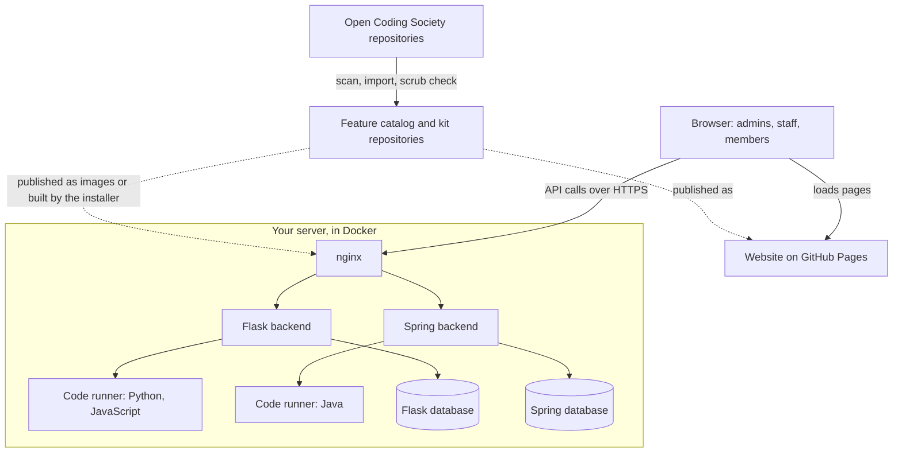

# OCS-in-a-Kit

OCS-in-a-Kit packages the Open Coding Society platform so any school or organization can run its own copy. It is a website plus two backend servers, with features grouped into three kits and switched on or off from one feature catalog. This page explains what it contains, how the parts work together, and how to set it up.

## At a glance

| | |
|---|---|
| **Current release** | `v0.2.0` |
| **Parts** | Website (Jekyll), Flask backend (Python), Spring backend (Java), installer |
| **Kits** | Vanilla, Education, Business |
| **Features** | 16, defined in one catalog |
| **Hosting** | Website on GitHub Pages; backends in Docker on a server you control |

| Repository | What it holds |
|---|---|
| [OCS-Kit](https://github.com/CSA-Admin-OCS/OCS-Kit) | Installer, canonical feature catalog, upstream import tool, install guide |
| [OCS-Kit-Pages](https://github.com/CSA-Admin-OCS/OCS-Kit-Pages) | Website: lessons, guides, profile, admin dashboard ([live demo](https://csa-admin-ocs.github.io/OCS-Kit-Pages/)) |
| [OCS-Kit-Flask](https://github.com/CSA-Admin-OCS/OCS-Kit-Flask) | Python API: logins, sections, AI chat proxy, code runner, social |
| [OCS-Kit-Spring](https://github.com/CSA-Admin-OCS/OCS-Kit-Spring) | Java API: people, groups, assignments, calendar, hall pass, admin pages |

## How the system works



- **The browser** loads static pages from GitHub Pages, then calls the two backends for logins and data.
- **nginx** terminates HTTPS on the server and forwards requests to each backend. The backend ports are not exposed directly.
- **Code runners** are locked-down containers that execute student code. Only the backends can reach them.
- **Data** stays in each backend's own database: SQLite by default, with MySQL also supported.
- **The catalog** decides which features are on. Each backend answers `404` for a disabled feature's routes, and the website hides its links.
- **New work** starts in the Open Coding Society repositories. The import tool scans them and brings features into the kit only after they pass a scrub check.

## The three kits

All three kits share one codebase in each repository. A kit is a preset list of features plus a set of role names, so fixes reach every kit at once.

| Kit | Who it is for | Admin role | Staff role | Member role |
|---|---|---|---|---|
| **Vanilla** | A simple site that can be handed to a student | Admin | Editor | User |
| **Education** | A computer science classroom | Admin | Teacher | Student |
| **Business** | An organization serving its own users | Admin | Manager | Member |

| What each role can do | |
|---|---|
| **Admin** | Everything, including managing users and roles and changing features |
| **Staff** | Day-to-day work such as content, groups, grading and approvals. Can see which features are on, but cannot change them |
| **Member** | Uses the site. New sign-ups get this role |

## Feature library

In the table, V is Vanilla, E is Education and B is Business. A blank cell means the feature is an add-on that an Admin can turn on in that kit.

| Feature | Category | V | E | B | What it does | Needs |
|---|---|---|---|---|---|---|
| **Core platform** | Core | ✓ | ✓ | ✓ | Login, accounts, roles, sections and groups, profile, admin pages, blog and notebook pipeline, search | Nothing |
| **Lessons** | Educational | | ✓ | | Python and Java courses, guides, lesson layouts, progress tracking | Nothing |
| **Assignments and grading** | Educational | | ✓ | | Assignments, submissions, grades, quizzes, quests, certificates, evaluations, student and teacher toolkit | Nothing |
| **AI grading** | Educational | | ✓ | | AI grading and feedback for free-response answers | `GEMINI_API_KEY` (Spring) |
| **Hall pass** | Educational | | ✓ | | Hall pass queues, student help queue, approval requests | `ADMIN_EMAIL` (Spring) |
| **Code runners** | General | | ✓ | | Run Python, JavaScript and Java in sandboxed containers | Nothing |
| **Game engine** | General | | ✓ | | JavaScript game engine, game projects, multiplayer, leaderboards, AI NPCs | Nothing |
| **AI chatbot** | General | | ✓ | ✓ | Website chatbot or tutor, answered through the backend so keys stay on the server | `GEMINI_API_KEY` (Flask) |
| **Social** | General | | ✓ | ✓ | Microblog, posts, comments, notes, announcements, chat and direct messages | Nothing |
| **Calendar** | General | | ✓ | ✓ | Calendar, events, issue and calendar sync | Nothing |
| **Analytics** | General | | ✓ | ✓ | Usage analytics, GitHub contribution stats, skill snapshots, dashboards | Nothing |
| **Resume builder** | General | | ✓ | ✓ | Personal resume and profile pages | Nothing |
| **Finance simulation** | General | | | | Simulated bank, stocks, crypto and probability games | Nothing |
| **Kasm virtual desktops** | General | | | | Kasm Workspaces integration | `KASM_SERVER`, `KASM_API_KEY`, `KASM_API_KEY_SECRET` (Flask) |
| **Face recognition** | General | | | | Face registration and login. Stores biometric data, so check your privacy policy first | Nothing |
| **Teaching examples** | General | | | | Classroom demo code and sample APIs and pages | Nothing |

Each feature in the catalog also has labels, such as `needs-api-key` or `privacy-sensitive`, and a setup guide listing its settings, where each one goes, manual steps, and how to check it works.

### Customizing features

| How | Example | When it applies |
|---|---|---|
| Installer | Pick a kit, then tick features on or off | At install |
| Backend `.env` | `KIT=education` and `FEATURES=+finance-sim,-hallpass` | On backend restart |
| Website `_config.yml` | `kit: name: education` and `features: ["+finance-sim"]` | On the next site build |
| Admin dashboard | **Admin → Manage features** | Immediately, no restart |

Only Admins can change features from the dashboard, and the backends enforce that.

## Set it up

You need Python 3.8+, Git and Docker. Run the installer as your normal user, not with `sudo`.

```bash
git clone https://github.com/CSA-Admin-OCS/OCS-Kit.git
cd OCS-Kit
./install.sh        # macOS and Linux
install.bat         # Windows
```

A page opens in your browser and asks for your kit, organization name, passwords and any API keys. It then downloads, configures and starts everything. Servers without a screen get the same questions in the terminal.

When it finishes:

1. Log in to the website as `admin`.
2. Open **Admin** to see your kit, users by role, and which features still need setup.
3. Open **Manage features** and follow the setup guide on each feature you want to use.

To go live, choose **Production server with a domain** in the installer. It writes nginx configs and lists the DNS records to create. Keep the website and both backends on subdomains of one domain, because browsers block login cookies between unrelated domains.

The [full install guide](https://github.com/CSA-Admin-OCS/OCS-Kit/blob/main/docs/INSTALL.md) covers each operating system, HTTPS, updates, backups and troubleshooting.

## Keeping the kit up to date

Development continues in the Open Coding Society repositories, and features move into the kit with the import tool in `OCS-Kit/sync`:

| Command | What it does |
|---|---|
| `scan` | Lists what is new or changed upstream and suggests a feature for it |
| `import` | Copies a feature and its dependencies, runs the scrub check, adds it to the catalog and commits to a review branch |
| `update` | Pulls upstream changes for features already in the kit, without overwriting kit-owned files |

The scrub check blocks school-specific text, keys and tokens, student data files and oversized files, so nothing reaches the kit unreviewed.

To add a new feature by hand, add one entry to the catalog with its category, labels, kit membership and setup guide, then map it to its code in each repository. Each repository has a check that fails if its catalog drifts from the shared one.
